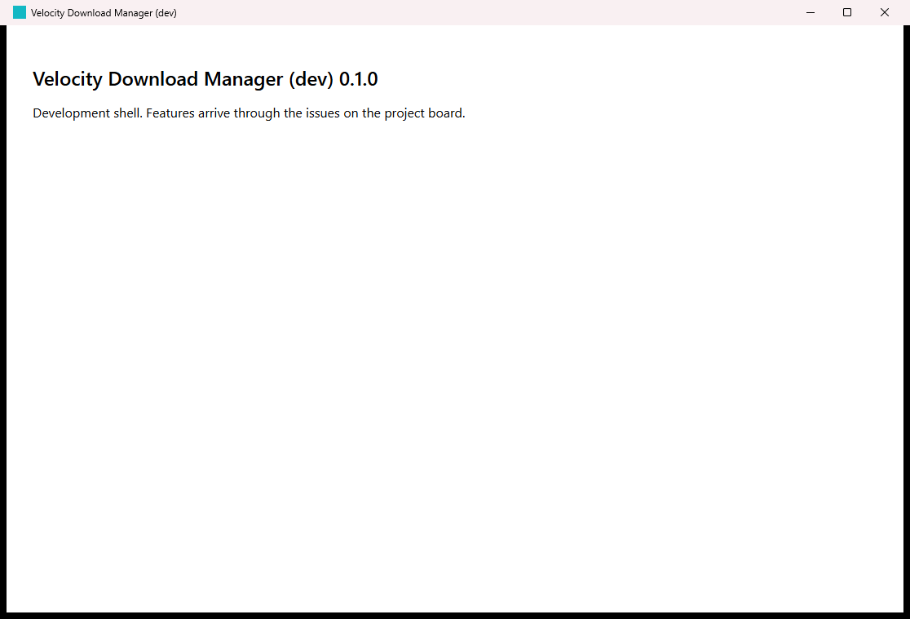
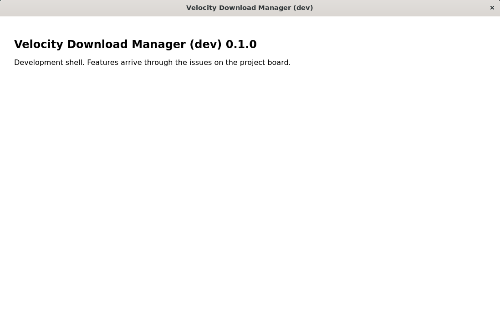

# Development setup

This page takes you from a fresh clone of the V2 repository to a running Velocity Download Manager development window on Windows, Linux or macOS. If something fails, see [TROUBLESHOOTING.md](TROUBLESHOOTING.md).

## Quick start

After installing the prerequisites below:

```sh
pnpm check:prereqs            # checks Node.js, pnpm, Rust and the platform libraries; prints the fix for anything missing
pnpm install --frozen-lockfile
pnpm dev                      # builds the Rust shell and opens the app with hot reload
```

The first `pnpm dev` compiles every Rust dependency and takes several minutes (see [Build times](#build-times)). Later runs reuse the build.

You should see a window titled **Velocity Download Manager (dev)** whose heading shows the name and version reported by the Rust core:



The same build on Linux (Ubuntu 24.04 under WSL2/WSLg):



## Prerequisites

| Tool | Version | Why |
|---|---|---|
| Node.js | `^22.13.0 \|\| ^24.0.0 \|\| >=26.0.0` (the `engines` field in `package.json`; set by Vitest and ESLint) | Frontend tooling |
| pnpm | exactly the version in `package.json` → `packageManager` (12.14.0) | Package manager |
| Rust | installed with rustup; `rust-toolchain.toml` pins the toolchain (1.99.1) and rustup installs it automatically | Desktop shell and core |
| Platform libraries | see below | Tauri's webview and native build |

`pnpm check:prereqs` checks all of these. It only reads your system; it never installs or changes anything.

### pnpm

Use one of the routes from the [pnpm installation docs](https://pnpm.io/installation):

- **Corepack** (bundled with the Node.js releases we support): run `corepack enable` once. Corepack then runs the exact pnpm version pinned in `package.json`.
- **npm**: `npx get-pnpm` (needs Node.js 22.13 or newer). pnpm's docs recommend this route on Windows, because Windows Defender may block the standalone installer.

Note that `pnpm setup` and `pnpm doctor` are built-in pnpm commands, which is why the prerequisite check is named `check:prereqs`.

### Windows 10/11

Requirements from the [Tauri prerequisites](https://v2.tauri.app/start/prerequisites/):

1. **Microsoft C++ Build Tools** with the **Desktop development with C++** workload: <https://visualstudio.microsoft.com/visual-cpp-build-tools/>.
2. **WebView2 Runtime**. It is preinstalled on Windows 10 (1803 and later) and Windows 11; otherwise install the Evergreen Bootstrapper from <https://developer.microsoft.com/microsoft-edge/webview2/>.
3. **Rust**: `winget install --id Rustlang.Rustup`, and choose the MSVC toolchain (`x86_64-pc-windows-msvc`) as the default host. Open a new terminal afterwards.
4. **Node.js** LTS from <https://nodejs.org/>, then pnpm as described above.

### Linux (Debian/Ubuntu)

```sh
sudo apt update
sudo apt install libwebkit2gtk-4.1-dev build-essential curl wget file libxdo-dev libssl-dev libayatana-appindicator3-dev librsvg2-dev
curl --proto '=https' --tlsv1.2 https://sh.rustup.rs -sSf | sh
```

Then install Node.js and pnpm. Fedora and Arch package lists are in the [Tauri prerequisites](https://v2.tauri.app/start/prerequisites/#linux).

### macOS

```sh
xcode-select --install
curl --proto '=https' --tlsv1.2 https://sh.rustup.rs -sSf | sh
```

Then install Node.js and pnpm.

## Everyday commands

| Command | What it does |
|---|---|
| `pnpm dev` | Run the desktop app with hot reload (Vite on port 1430, Rust rebuilt on change) |
| `pnpm dev:web` | Run only the web UI in a browser (native commands are unavailable there) |
| `pnpm check:fast` | Level L1 checks: `cargo fmt --check`, clippy with `-D warnings`, `cargo test`, `tsc`, ESLint (zero warnings), Vitest. It runs every check even after a failure and prints a summary |
| `pnpm test:focused -- <area>` | Level L2: the tests of one crate, `frontend` or `scripts` while you iterate |
| `pnpm check:pr` | Level L3 run locally: only the checks this branch's changes need |
| `pnpm check:full` | Level L4 run locally: L1, then the production web build and the Rust release build |
| `pnpm check:links` | Relative links and heading anchors in every Markdown file |
| `pnpm test`, `pnpm test:watch` | Frontend and script unit tests (Vitest), once or in watch mode |
| `pnpm rust:test` | Rust unit tests |
| `pnpm typecheck`, `pnpm lint` | TypeScript and ESLint on their own |

Run `pnpm check:fast` before every pull request. [TESTING.md](TESTING.md) describes each level, how `check:pr` picks checks, and the build settings that keep feedback fast.

## Running beside the original Velocity Download Manager

V2 will replace V1 under the same product name, Velocity Download Manager (PO decision, #11). During development, both run side by side:

| | V1 | V2 development build |
|---|---|---|
| Product name | Velocity Download Manager | Velocity Download Manager (dev) |
| Bundle identifier | `com.velocity.downloadmanager` | `dev.velocity.downloadmanager.v2` (placeholder until #11 records the final value) |
| Dev server port | 1420 | 1430 |

The bundle identifier, not the name, keeps the apps apart: it decides the data directory and the single-instance lock. Tests in `src-tauri/src/lib.rs` fail if V2's identifier or dev port ever matches V1's. How a V2 release takes over from an installed V1 is decided in #81 (installer) and #24 (data import).

## Build times

The two tables below were measured on 2026-10-21, before the #3 profile change ([check timings](#check-timings) has the current figures).

Windows 11 (build 26200), Intel Core i7-13620H (16 logical CPUs), 15.7 GiB RAM, NVMe SSD, Rust 1.99.1, Node.js 24.12.0, pnpm 12.14.0:

| Step | Time |
|---|---|
| First `cargo build --workspace` from an empty `target/` | 278 s |
| `pnpm check:fast`, first run (clippy compiles its own artefacts) | 128 s |
| `pnpm check:fast`, warm | 7 s |
| `cargo build --workspace` with no changes | 3 s |
| Rebuild after a one-line change in `crates/velocity-core` | 19 s |
| Rebuild after a one-line change in `src-tauri` | 17 s |
| Vite dev server start | 0.23 s |

Linking the desktop executable dominates incremental rebuilds. Issue #3 tuned this (see [check timings](#check-timings)).

Linux: Ubuntu 24.04.4 LTS under WSL2 (kernel 6.6.87.2) on the same PC, limited to 2 vCPUs and 1.9 GiB RAM, with the same tool versions:

| Step | Time |
|---|---|
| First `cargo build --workspace` from an empty `target/` | 413 s |
| `pnpm check:fast`, first run | 191 s |
| `pnpm check:fast`, warm | 8 s |
| `cargo build --workspace` with no changes | < 1 s |
| Rebuild after a one-line change in `crates/velocity-core` | 17 s |

| Platform | Clean-clone run |
|---|---|
| Windows 11 | **PASS** (2026-10-21, machine above) |
| Linux (Ubuntu 24.04, WSL2/WSLg) | **PASS** (2026-10-21). WSL is a real Linux kernel and userland, but not a native desktop install; WebKitGTK rendered through WSLg |
| macOS | **NOT RUN**: no macOS machine was available |

### Check timings

Measured 2026-10-21 for #3 on the two machines above. Each figure is the median of `node scripts/check-fast.mjs` wall time after one warm-up run. "One-file change" means appending a comment line to `crates/velocity-core/src/lib.rs` before each run. That rebuilds the core and the desktop shell that depends on it.

| `pnpm check:fast` | Before tuning | After tuning |
|---|---|---|
| Windows, no-op | 9.2 s | 8.9 s |
| Windows, one-file change | 20.9 s | 14.0 s |
| Linux (WSL2, 2 vCPU, 1.9 GiB), no-op | 6.1 s | 5.5 s |
| Linux (WSL2, 2 vCPU, 1.9 GiB), one-file change | 66.7 s (18–123 s) | 7.0 s |

- **Windows:** 5 runs on each side, with the same scripts and only the `Cargo.toml` profile change reverted for "before". A first measurement on `main`'s scripts, with 3 runs, gave 7.5 s and 25.8 s.
- **Linux:** 3 runs before, on `main`, and 5 runs after.
- **Where the time goes:** in a no-op run, mostly ESLint (about 4.5 s on Windows, 3 s on Linux). After a Rust change, mostly `cargo test`, which re-links the desktop shell. Before tuning, that link wrote a staticlib of about 660 MB on Linux; it is now about 140 MB. Under WSL's 1.9 GiB of memory, the link time varied a lot.

`pnpm check:full` on Windows: 249 s, of which the Rust release build took 232 s. Linux (WSL2): 224 s across the checks, of which the Rust release build took 215 s.

## Repository layout

| Path | Purpose |
|---|---|
| `src/` | React and TypeScript UI. It talks to Rust only through typed Tauri commands |
| `src-tauri/` | Tauri 2 desktop shell. Commands stay thin and delegate to the core |
| `crates/velocity-core/` | Core domain logic in Rust |
| `scripts/` | Developer scripts (`check:prereqs`, the `check:*` and `test:focused` commands) and their tests |
| `docs/` | Project documentation; [README.md](README.md) maps every document |
